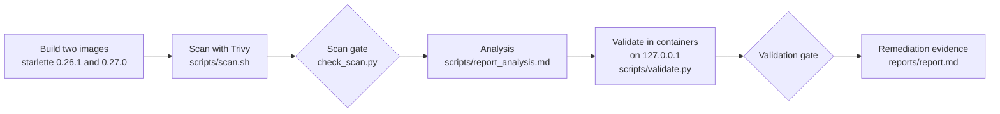

# cve_prooflab

A small local lab that builds a vulnerable and a patched image of a Starlette app, scans both with Trivy, and checks one known flaw, [CVE-2023-29159](https://github.com/advisories/GHSA-v5gw-mw7f-84px), with a safe test on `127.0.0.1`.

CVE-2023-29159 is a path traversal in Starlette `StaticFiles`, affecting `starlette >= 0.13.5, < 0.27.0`. When a served folder has a sibling whose name starts with the same text (`static` and `static_disallow`), a request such as `/static/../static_disallow/marker.txt` reads a file from the sibling.

## Safety scope

- Every test request goes to the lab's own container on this machine. The container port is published on `127.0.0.1` only, so other machines cannot reach the app.
- Publishing on `127.0.0.1` does not stop the container from making outbound connections. The app makes none.
- The only file the flaw can expose is a lab marker with fixed text (`app/static_disallow/marker.txt`). The images hold no secrets and no real data.
- The test requests read; they do not write, delete, or run code. The traversal request has the same form as the advisory's proof of concept.
- The app also holds a `/status` endpoint, added on purpose so that a later advisory (CVE-2026-48817) has a reachable target for a model comparison task. It returns fixed text and reads no file.
- No image is pushed to a registry. `scripts/validate.py` removes each container it starts, also when a run fails or is interrupted.

## Pipeline



The scan gate passes when CVE-2023-29159 is reported for the vulnerable image and not for the patched one. The validation gate passes when each test's outcome matches the table under Method. Neither gate requires zero findings: the patched image still carries other advisories.

## Setup

You need:

Tested on Linux x86-64.

- Docker (tested with 29.10.0).
- Trivy 0.76.2. `scripts/scan.sh` refuses any other version. Install it from the [official release](https://github.com/aquasecurity/trivy/releases/tag/v0.76.2) and check it:

  ```bash
  gh release download v0.76.2 --repo aquasecurity/trivy --pattern 'trivy_0.76.2_Linux-64bit.tar.gz' --pattern 'trivy_0.76.2_checksums.txt'
  grep ' trivy_0.76.2_Linux-64bit.tar.gz$' trivy_0.76.2_checksums.txt | sha256sum -c -
  gh release verify-asset v0.76.2 trivy_0.76.2_Linux-64bit.tar.gz --repo aquasecurity/trivy
  ```

  Then extract `trivy` from the tarball and put it on your `PATH`. `gh` needs a GitHub login; without one, download the two files from the release page and run the `sha256sum` check.

- uv 0.13.9, from the [official release](https://github.com/astral-sh/uv/releases/tag/0.13.9), checked the same way (`sha256sum -c` on the `.sha256` file, then `gh release verify-asset`).
- `jq`, and `gh` for the release checks.

## Commands

Run these from the repository root.

Build both images. The build argument has no default, so each build names its variant:

```bash
docker build --build-arg REQUIREMENTS=requirements-vulnerable.txt -t cve_prooflab:vulnerable app/
docker build --build-arg REQUIREMENTS=requirements-patched.txt -t cve_prooflab:patched app/
```

Scan both images and check the scan gate:

```bash
scripts/scan.sh
uv run --python 3.12 --no-project scripts/check_scan.py
```

`scripts/check_scan.py` ends with `SCAN GATE: PASS` and exits 0.

Run the validation in containers on `127.0.0.1` and check the validation gate:

```bash
uv run --python 3.12 --no-project --with-requirements requirements-dev.txt scripts/validate.py
```

pytest reports one failed test for the vulnerable image, `test_sibling_folder_is_not_served`. That failure is the expected evidence of the flaw. The script ends with `VALIDATION GATE: PASS` and exits 0.

Write the report:

```bash
uv run --python 3.12 --no-project scripts/generate_report.py
```

The script prints nothing and exits 0. `reports/report.md` starts with `RESULT: both gates passed (scan gate PASS, validation gate PASS).` Trivy findings other than CVE-2023-29159 change as its database updates; neither gate depends on them.

`reports/report.md` is generated and not committed. So are the Trivy JSON files and the JUnit XML files in `reports/`.

## CI

The workflow `.github/workflows/security.yml` runs on each pull request. Its `lab` job runs the commands above on a GitHub-hosted runner: [workflow runs](https://github.com/parthjeet/cve_prooflab/actions/workflows/security.yml). The job installs Trivy 0.76.2 and uv 0.13.9 and checks each by sha256, builds both images, runs both gates, and writes the report. It pushes no image and has read-only access to the repository.

Each run page holds the artifact `cve-prooflab-reports`: `report.md`, the three Trivy JSON files, and the two JUnit XML files. GitHub keeps an artifact for 90 days and asks for a login to download it. The step "Show runner tools" prints the runner's Docker, `jq`, and Python versions.

## The Trivy finding

From the vulnerable image's scan:

```bash
jq '.Results[].Vulnerabilities[]? | select(.VulnerabilityID=="CVE-2023-29159") | {VulnerabilityID, PkgName, InstalledVersion, FixedVersion, Severity, VendorIDs}' reports/trivy-vulnerable.json
```

```json
{
  "VulnerabilityID": "CVE-2023-29159",
  "PkgName": "starlette",
  "InstalledVersion": "0.26.1",
  "FixedVersion": "0.27.0",
  "Severity": "MEDIUM",
  "VendorIDs": [
    "GHSA-v5gw-mw7f-84px"
  ]
}
```

The patched image's scan has no entry for CVE-2023-29159. The report lists the Trivy version, the database date, and the scan dates.

## Method

1. Scan both images with Trivy, and check that CVE-2023-29159 is reported for the vulnerable image only.
2. Read the advisory, the NVD record, and the fix, and write down what is observed and what is only a hypothesis (`scripts/report_analysis.md`).
3. Validate the flaw with a test that sends harmless GET requests to each container on `127.0.0.1`.
4. Patch by moving `starlette` from `0.26.1` to `0.27.0`, the first fixed version, and rerun the scan and the test.

### Tools

- Trivy 0.76.2, installed from the official GitHub release. Before the install, Aqua Security's advisory [GHSA-69fq-xp46-6x23](https://github.com/aquasecurity/trivy/security/advisories/GHSA-69fq-xp46-6x23) (a March 2026 supply chain attack on some Trivy releases) was read; 0.76.2 is not affected. The tarball's checksum matched `trivy_0.76.2_checksums.txt`, and `gh release verify-asset` confirmed it belongs to the release.
- uv 0.13.9, installed and checked the same way. Earlier uv versions carry advisories GHSA-hq85-5cpj-mr62, GHSA-4gg8-gxpx-9rph, and GHSA-pjjw-68hj-v9mw.
- Docker 29.10.0. Base image `python:3.12-slim`, pinned by digest.

### What the results prove, and what they do not

The validation runs each image in a container published on `127.0.0.1` only and sends three GET requests:

| Test | Request | Vulnerable `0.26.1` | Patched `0.27.0` |
|---|---|---|---|
| `test_public_file_is_served` | `/static/index.html` | pass | pass |
| `test_sibling_folder_is_not_served` | `/static/../static_disallow/marker.txt` | fail: 200 and the marker text | pass: 404 |
| `test_unrelated_folder_is_not_served` | `/static/../other/marker.txt` | pass | pass |

The table gives the expected outcome of each test. The run of 2026-11-18 matched it. `scripts/validate.py` printed (columns: image, test, expected outcome, actual outcome, HTTP status):

```text
vulnerable test_public_file_is_served passed passed 200 MATCH
vulnerable test_sibling_folder_is_not_served failed failed 200 MATCH
vulnerable test_unrelated_folder_is_not_served passed passed 404 MATCH
vulnerable test_sibling_folder_is_not_served marker expected status 200 body 'LAB-MARKER-SIBLING' actual status 200 body 'LAB-MARKER-SIBLING' MATCH
patched test_public_file_is_served passed passed 200 MATCH
patched test_sibling_folder_is_not_served passed passed 404 MATCH
patched test_unrelated_folder_is_not_served passed passed 404 MATCH
VALIDATION GATE: PASS
```

The results prove:

- In these images, `starlette==0.26.1` serves a file from a sibling folder whose name starts with `static`, and `starlette==0.27.0` does not.
- Neither version serves a file from an unrelated folder, so the flaw needs that sibling-name precondition.

Two earlier checks, not this test, tie the changed result to the fix: the two requirements files differ only in the `starlette` pin, and in the installed package the fix is the only change in `staticfiles.py` (`scripts/report_analysis.md`).

The results do not prove:

- That `0.27.0` is safe to deploy. The patched scan still lists later `starlette` advisories; use the latest supported release.
- Anything about other request patterns or folder layouts.
- Anything about a sibling file such as `static1.txt`. The advisory's proof of concept and the fix commit's test name that case; the lab tests a sibling folder only.
- Any effect of the flaw other than the read of one file.
- Anything about the `/status` route or CVE-2026-48817. No gate tests it.

## How Claude helped

_Written by Claude._

Claude (Claude Code, with Claude subagents) did the work listed below. The owner chose the CVE and the dependency approach, installed Trivy and uv with the checked commands, and ran the `jq` query on the vulnerable scan. The owner approved each commit, reviewed the app and the Dockerfile before the first build, approved the validation approach before any test ran against a container, and reviewed the test and the validation script before their first run.

- Shortlisted CVEs from the GitHub Advisory Database and OSV, recommended CVE-2023-29159, and reproduced it on the host with one harmless request.
- Planned the lab and wrote the app, the Dockerfile, the requirements files, the scripts, and the tests. Checked each script with failure cases, and checked the test and the validation script against a server on the host before any traversal request went to a container.
- Found the March 2026 Trivy supply chain advisory and three advisories against the uv version on the host, and wrote install steps that check checksums and release attestations.
- Read the 0.27.0 release notes, the fix commit, and the installed source of both versions, and wrote the analysis.
- Ran the scans and the validation, generated the report, and wrote this README. The analysis in the report is Claude's draft.
- At the owner's request, read the GitHub advisory and the NVD record in the owner's place and compared them with the Trivy finding.
